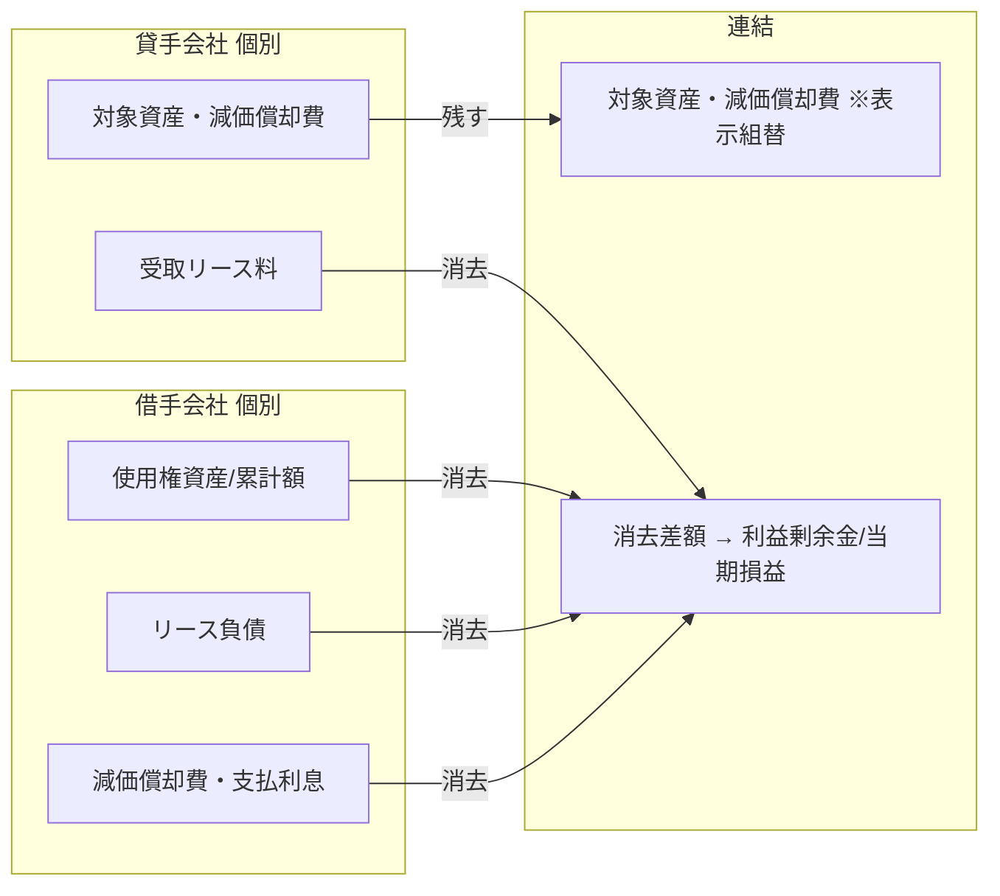
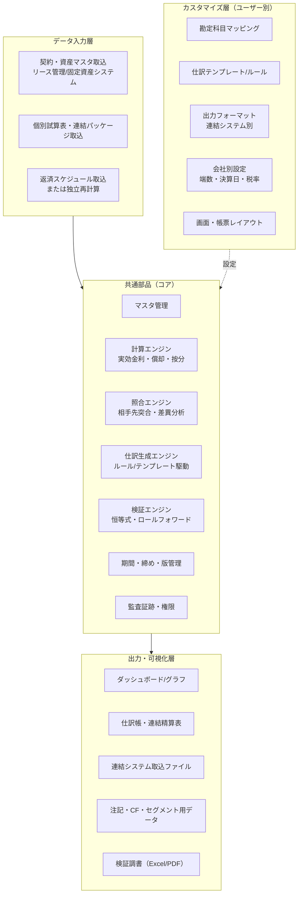
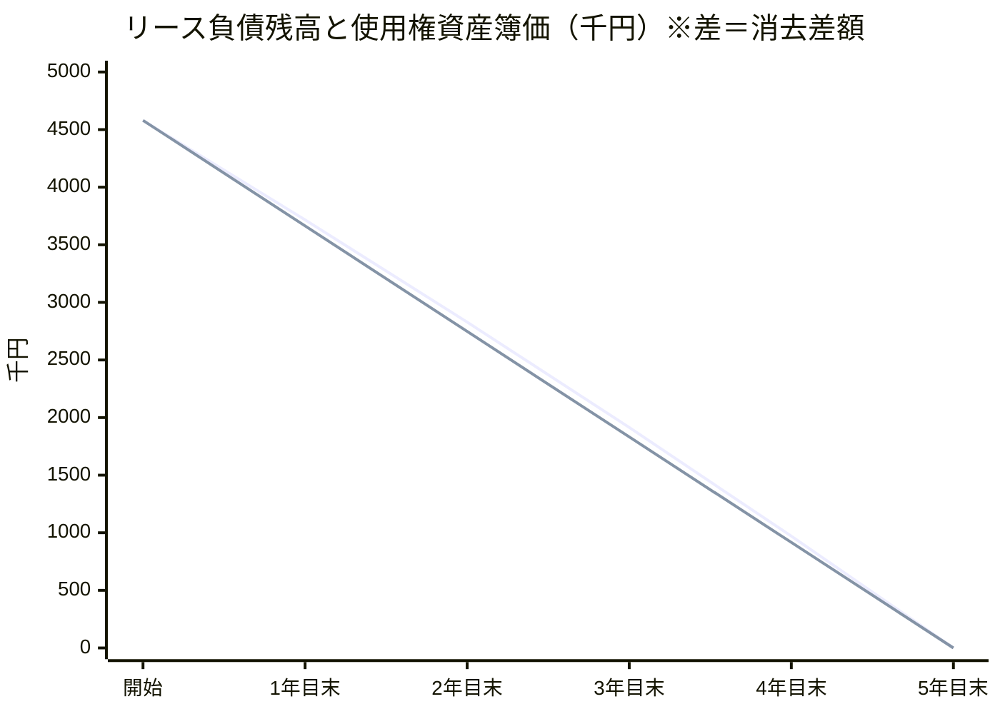
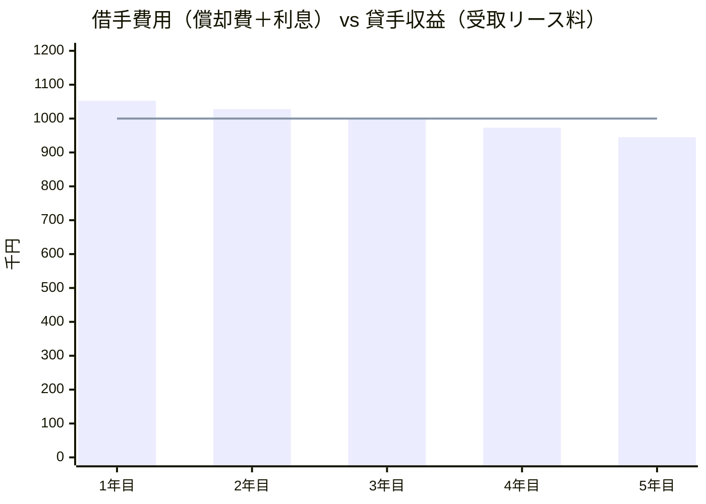
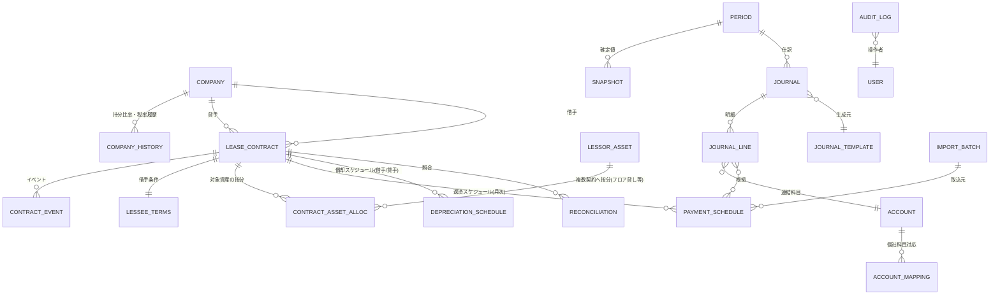

# 新リース会計基準 連結決算対応「グループ内リース仕訳作成アプリ」要件定義書（ドラフト v0.1）

| 項目 | 内容 |
|---|---|
| 対象基準 | 企業会計基準第34号「リースに関する会計基準」／企業会計基準適用指針第33号（2027年4月1日以後開始する連結会計年度の期首から適用。早期適用は2025年4月1日以後開始年度から可） |
| 対象業務 | 連結グループ内リース取引に関する **個社修正仕訳** と **連結修正仕訳** の自動作成・検証・可視化 |
| 前提 | ①借手側のオンバランス（使用権資産・リース負債の計上）は個別決算で処理済み ②貸手は **オペレーティング・リース** として処理 ③共通部品（コア）＋ユーザー別カスタマイズ層の2層構成 |
| 重視点 | **検証性**（根拠への遡及・検算・監査証跡）と **可視性**（表・グラフ・図での説明） |

> 実装：本要件の一部を `app/`（静的Webアプリ）に実装している。実装済み・未実装の一覧は §14「実装状況」とアプリの「使い方・設例」画面を参照（未実装の M 要件も明記）。
>
> 要件IDの付番：`FR`=機能要件、`VR`=検証性要件、`UI`=可視化要件、`CU`=カスタマイズ要件、`NFR`=非機能要件。
> 優先度：**M**=Must（初期リリース必須）／**S**=Should／**C**=Could（将来拡張）。

---

## 目次

1. [スコープと前提](#1-スコープと前提)
2. [会計上の考え方（アプリが表現すべきロジック）](#2-会計上の考え方アプリが表現すべきロジック)
3. [全体アーキテクチャ（共通部品とカスタマイズ層）](#3-全体アーキテクチャ共通部品とカスタマイズ層)
4. [機能要件](#4-機能要件)
5. [検証性要件](#5-検証性要件)
6. [可視化要件（画面・グラフ）](#6-可視化要件画面グラフ)
7. [データモデル](#7-データモデル)
8. [カスタマイズ要件（拡張ポイント）](#8-カスタマイズ要件拡張ポイント)
9. [非機能要件](#9-非機能要件)
10. [設例（仕訳エンジンの期待値）](#10-設例仕訳エンジンの期待値)
11. [会計方針の論点と既定値（会計方針設定メニュー）](#11-会計方針の論点と既定値会計方針設定メニュー)
12. [テストシナリオ](#12-テストシナリオ)
13. [開発フェーズ案](#13-開発フェーズ案)

---

## 1. スコープと前提

### 1.1 対象範囲（In Scope）

| # | 対象 |
|---|---|
| 1 | 連結子会社間・親子会社間の不動産／動産リース（借手：使用権資産・リース負債を計上済、貸手：オペレーティング・リースとして自社資産を保有し受取リース料を計上） |
| 2 | 管理対象：相手会社、契約、使用権資産（取得原価・減価償却累計額）、リース負債（返済スケジュール・流動／固定区分）、貸手側の対象資産・減価償却、受取リース料 |
| 3 | 個社修正仕訳（科目組替、方針統一、決算期ズレ調整、個別税効果の調整 等） |
| 4 | 連結修正仕訳（開始仕訳、当期消去仕訳、組替仕訳、税効果、非支配株主持分、為替換算） |
| 5 | 契約イベント：新規、条件変更、再測定、中途解約、期間満了、購入オプション行使、減損 |
| 6 | 連結CF計算書・注記・セグメント情報用の消去データ |
| 7 | 期間：年次・半期・四半期・月次 |

### 1.2 対象外（Out of Scope、ただし拡張余地を残す）

| # | 対象外 | 理由・扱い |
|---|---|---|
| 1 | 借手の個別決算におけるオンバランス計算そのもの | 前提で処理済み。ただし **検証目的の独立再計算** は行う（FR-CAL-010） |
| 2 | 貸手のファイナンス・リース（リース債権・リース投資資産） | 前提外。将来拡張としてテンプレートのみ設計（CU-TPL-005） |
| 3 | グループ外とのリース取引 | 消去対象外。ただし **転リース** の判定のために外部ヘッドリースの情報は参照可能とする |
| 4 | 持分法適用会社とのリース | 原則消去しない。未実現損益が生じるケース（購入オプション行使等）のみ C 優先で対応 |

### 1.3 用語

| 用語 | 本書での意味 |
|---|---|
| 借手会社 | グループ内リースの借手（使用権資産・リース負債を計上） |
| 貸手会社 | グループ内リースの貸手（オペレーティング・リース：対象資産を自社資産として計上・償却） |
| 個社修正仕訳 | 連結パッケージ段階で各社の個別財務諸表を連結用に修正する仕訳（会社単位） |
| 連結修正仕訳 | 合算後に連結グループの観点で行う消去・組替仕訳（会社ペア単位） |
| 消去差額 | 「リース負債残高 − 使用権資産帳簿価額」。借手の費用（償却費＋利息）と貸手の収益（受取リース料）の期間差に起因する累積損益差 |

---

## 2. 会計上の考え方（アプリが表現すべきロジック）

### 2.1 グループ視点の基本

連結上、グループ内リースは **「リースが存在しない」**（貸手会社が保有する資産をグループ内で使用しているだけ）と扱う。したがって：

- 借手の **使用権資産・減価償却累計額・リース負債・減価償却費・支払利息** は全額消去
- 貸手の **受取リース料** は全額消去
- 貸手の **対象資産と減価償却費は連結上も残す**（使用実態に応じて表示科目を組替）
- 借手の費用（償却費＋利息：逓減型）と貸手収益（定額型）の差が **期間損益差** として生じ、その累積額は常に「リース負債残高 − 使用権資産帳簿価額」に一致する



### 2.2 消去差額の恒等式（エンジンの検算基準）

当初 `使用権資産 = リース負債`（初期直接費用・前払リース料・インセンティブ・原状回復費用がない場合）、かつ `受取リース料 = 支払リース料` のとき：

```
Σ(借手の償却費＋支払利息) − Σ(貸手の受取リース料)  ＝  期末リース負債残高 − 期末使用権資産帳簿価額
```

使用権資産とリース負債の当初差額（初期直接費用等）や受払差（未収・未払、消費税、変動リース料、非リース構成部分）がある場合は、その要因を **差異要因として明示的に分解** して恒等式を拡張する（FR-REC-003・VR-CHK-003）。

---

## 3. 全体アーキテクチャ（共通部品とカスタマイズ層）



設計原則：

| # | 原則 |
|---|---|
| 1 | **ロジックと設定の分離**：会計ロジック（消去の考え方）はコア、科目名・仕訳の粒度・出力形式は設定（コード修正なしで切替） |
| 2 | **計算結果の不変性**：確定（ロック）済み期間の結果はスナップショット保存し、再計算しても上書きしない |
| 3 | **全数値に根拠リンク**：画面上のすべての金額から計算根拠（スケジュール行・取込元・ルール）に遡れる |
| 4 | **二重計算による検証**：取込値（借手の帳簿値）とアプリの独立再計算値を常に並べて差異を表示 |

---

## 4. 機能要件

### 4.1 マスタ管理（FR-MST）

| ID | 要件 | 優先 |
|---|---|---|
| FR-MST-001 | **会社マスタ**：会社コード、名称、連結区分（親/連結子/持分法/非連結）、持分比率（期別履歴）、決算日、機能通貨、セグメント、法定実効税率（期別）、適用会計基準（日本基準/IFRS/US GAAP） | M |
| FR-MST-002 | **相手会社ペア管理**：貸手会社×借手会社の組合せごとに契約を束ね、ペア単位で照合・仕訳作成 | M |
| FR-MST-003 | **リース契約マスタ**：契約番号、貸手、借手、対象資産（名称・所在地・資産区分：建物/機械/車両/土地 等）、契約日、リース開始日、解約不能期間、延長・解約オプションと行使の合理的確実性の判断、リース期間、支払頻度（月/四半期/年）、前払/後払、リース料（段階賃料・フリーレント含む）、通貨、消費税区分 | M |
| FR-MST-004 | **借手側情報**：使用権資産の取得原価（内訳：リース負債当初測定額・初期直接費用・前払リース料・インセンティブ・原状回復費用）、償却方法・償却期間、割引率（追加借入利子率等）、計上科目、計上部門（製造/販管） | M |
| FR-MST-005 | **貸手側情報**：対象資産の資産番号、取得原価、償却方法、耐用年数、残存価額、計上科目（賃貸資産等）、減価償却費の計上科目（賃貸原価/営業外費用 等）、受取リース料の計上科目（売上高/営業外収益） | M |
| FR-MST-006 | **非リース構成部分**（維持管理・サービス料）の区分有無・金額、**変動リース料**（売上連動・指数連動）の条件 | M |
| FR-MST-007 | **敷金・保証金・前受/前払リース料・原状回復義務** の相手先別残高 | S |
| FR-MST-008 | **勘定科目マスタ**：個社科目→連結科目のマッピング、グループ内/外の相手先区分、流動/固定区分、CF区分、注記区分 | M |
| FR-MST-009 | マスタの **有効期間管理（履歴）**：持分比率、税率、契約条件変更を「いつから有効か」で保持し、過去期間の再現を可能にする | M |
| FR-MST-010 | 契約と外部ヘッドリース（転リースの元契約）の紐付け | C |

### 4.2 データ取込（FR-IMP）

| ID | 要件 | 優先 |
|---|---|---|
| FR-IMP-001 | Excel/CSV による契約・資産・スケジュールの一括取込（テンプレート提供、列マッピングは設定で変更可） | M |
| FR-IMP-002 | 借手の **既存返済スケジュール**（期首残高・支払額・利息・元本・期末残高）と **償却スケジュール** の取込 | M |
| FR-IMP-003 | 個別試算表／連結パッケージ（相手先別残高・取引高）の取込 | M |
| FR-IMP-004 | 取込時バリデーション：必須項目、日付整合（開始日≦終了日）、残高の連続性（前期末＝当期首）、貸借一致、重複契約、未登録会社コード。ファイル自体の安全性検査は NFR-013 | M |
| FR-IMP-005 | 取込履歴（ファイル名・ハッシュ値・取込者・日時・件数）を保存し、どの取込データから仕訳が作られたか追跡可能 | M |
| FR-IMP-006 | 前回取込との差分表示（追加・変更・削除された契約／金額） | S |
| FR-IMP-007 | API 連携（リース管理システム、固定資産システム、連結会計システム） | C |

### 4.3 計算エンジン（FR-CAL）

| ID | 要件 | 優先 |
|---|---|---|
| FR-CAL-001 | 実効金利法によるリース負債スケジュール生成（月次単位で保持し、任意の決算期間に集計） | M |
| FR-CAL-002 | 使用権資産償却スケジュール（定額法、償却期間＝リース期間または経済的耐用年数〔所有権移転・購入オプション行使が合理的に確実な場合〕） | M |
| FR-CAL-003 | 期中開始・期中終了時の **月割/日割** の選択（会社別設定） | M |
| FR-CAL-004 | 前払（期首払）／後払（期末払）、フリーレント、段階賃料、不規則支払への対応 | M |
| FR-CAL-005 | **端数処理** の設定（円未満・千円未満、四捨五入/切捨/切上、最終回で残高ゼロ調整） | M |
| FR-CAL-006 | リース負債の **流動/固定区分**（決算日後1年以内返済元本の自動算定） | M |
| FR-CAL-007 | 注記用 **満期分析**（1年以内／1〜2年／2〜3年／3〜4年／4〜5年／5年超 等、区分は設定可） | M |
| FR-CAL-008 | 外貨建リース：リース負債の期末換算（CR）、使用権資産の取得時レート（HR）、為替差損益算定、在外子会社の財務諸表換算（PL：AR、BS：CR） | S |
| FR-CAL-009 | 貸手側の対象資産の償却スケジュール（取込または再計算） | M |
| FR-CAL-010 | **独立再計算**：取込値とは別にマスタ条件から再計算し、取込値との差異を契約・期間単位で表示（許容差は設定） | M |
| FR-CAL-011 | 決算日が異なる子会社（例：12月決算）の期間対応（3か月ズレの数値を当期に対応付け、重要な取引の調整額を算出） | M |
| FR-CAL-012 | 計算パラメータ（割引率・期間・金額）を変えた **シミュレーション**（確定データとは別領域で実行） | C |

### 4.4 個社修正仕訳（FR-IND）

各社の個別財務諸表を連結用に揃えるための、**会社単位** の修正。

| ID | 修正内容 | 代表仕訳（例） | 優先 |
|---|---|---|---|
| FR-IND-001 | **科目組替**：個社科目（例：旧基準名称「リース資産」「リース債務」）を連結科目「使用権資産」「リース負債」へ。グループ内／外の相手先区分を付与（「リース負債（グループ内）」等の補助区分） | 使用権資産 ／ リース資産 | M |
| FR-IND-002 | **流動/固定の組替**：個社で区分していない場合、1年内返済予定額を流動へ | リース負債(固定) ／ リース負債(流動) | M |
| FR-IND-003 | **会計方針の統一**：短期リース・少額リースの簡便法の適用範囲、リース期間判断、非リース構成部分の区分の要否などが会社間で異なる場合の修正（方針差異一覧から自動判定） | 例：使用権資産／リース負債（未計上分の計上）、または逆仕訳 | S |
| FR-IND-004 | **貸手・借手の計上時期差異の修正**：一方のみ計上（未収/未払の計上漏れ、請求遅延）を修正 | 未収収益／受取リース料 | M |
| FR-IND-005 | **決算期ズレ調整**：子会社決算日と連結決算日の間に生じた重要な取引（新規契約・解約・条件変更等）の調整 | 契約内容に応じ生成 | S |
| FR-IND-006 | **貸手の表示組替（会社内）**：受取リース料の計上区分（売上高/営業外収益）、対象資産の表示（賃貸資産）を連結表示方針に統一 | 営業外収益／売上高 | S |
| FR-IND-007 | **在外子会社の基準差調整**：IFRS第16号・ASC第842号適用会社の処理と日本基準の差異（実務対応報告第18号の取扱いに従う）。差異項目はテンプレート化 | 差異内容に応じ生成 | S |
| FR-IND-008 | **個別税効果の再計算**：上記修正に伴う繰延税金資産/負債 | 繰延税金資産／法人税等調整額 | S |
| FR-IND-009 | **誤謬・未処理の修正**：照合で判明した個別側の誤り（金額・科目・期間）を個社修正として起票し、照合結果と紐付け | 内容に応じ | M |
| FR-IND-010 | 個社修正の **翌期繰越**（洗替/継続の区分を仕訳ごとに設定） | — | M |

### 4.5 連結修正仕訳（FR-CON）

**会社ペア×契約単位** で生成し、連結システムへは集約単位（設定）で出力する。

#### 4.5.1 仕訳テンプレート一覧（コア標準）

| # | 区分 | 借方 | 貸方 | 金額の根拠 | 優先 |
|---|---|---|---|---|---|
| C-01 | 開始仕訳（前期末累計の引継） | リース負債（前期末残）<br/>使用権資産減価償却累計額（前期末）<br/>（差額）利益剰余金期首残高 | 使用権資産（取得原価）<br/>（差額）利益剰余金期首残高 | 前期末確定スナップショット | M |
| C-02 | 新規契約の消去 | リース負債 | 使用権資産 | 当期新規契約の当初測定額 | M |
| C-03 | 当期償却費の消去 | 使用権資産減価償却累計額 | 減価償却費（借手の計上区分：売上原価/販管費） | 償却スケジュール | M |
| C-04 | 当期リース料の消去 | 受取リース料（貸手） | 支払利息（借手）<br/>リース負債（元本返済額） | 返済スケジュール | M |
| C-05 | 未収・未払リース料の相殺 | 未払費用（借手） | 未収収益（貸手） | 照合結果 | M |
| C-06 | 前受・前払リース料の相殺 | 前受収益（貸手） | 前払費用・使用権資産取得原価算入分（借手） | 照合結果 | S |
| C-07 | 変動リース料の消去 | 受取リース料（変動） | 変動リース費用 | 取引高 | M |
| C-08 | 非リース構成部分の消去 | 売上高/受取サービス料（貸手） | 業務委託費等（借手） | 取引高 | M |
| C-09 | 敷金・保証金の相殺 | 預り保証金（貸手） | 差入保証金（借手） | 残高 | S |
| C-10 | 流動/固定の組替 | リース負債（流動）消去額の調整 | リース負債（固定） | 1年内元本 | M |
| C-11 | 貸手資産の表示組替 | 建物・機械装置等（使用実態） | 賃貸資産 | 資産マスタ | S |
| C-12 | 貸手減価償却費の表示組替 | 売上原価（製造）/販管費（借手の使用部門） | 賃貸原価/営業外費用 | 償却スケジュール×借手の計上部門 | S |
| C-13 | 税効果 | 法人税等調整額（当期の消去差額増加時） | 繰延税金資産（会社別の純額。借手・貸手の個別税効果の取消） | 会社別に「消去による純資産修正額 × 法定実効税率」の期末額 − 期首額。**差額が減少（マイナス）の場合は貸借逆**（繰延税金資産／法人税等調整額） | M |
| C-14 | 非支配株主持分への按分 | 非支配株主に帰属する当期純利益（連結利益を増加させる場合） | 非支配株主持分 | （借手の純資産修正額＋貸手の純資産修正額）から税効果を控除した額 × **借手会社**の非支配株主持分比率の増減。受払のタイミング差は借手・貸手の合計で相殺され按分対象外。比率が期中に変わった場合は変動月の前月末で区分し、比率変動分は資本剰余金（翌期以降は開始仕訳で引継ぎ）。連結利益を減少させる場合は貸借逆。按分要否は POL-01、按分替えの分担は POL-14 | M |
| C-15 | 為替差損益の消去（外貨建） | 為替差損益 | 為替換算調整勘定 等 | 借手のリース負債換算差額 | S |
| C-16 | 棚卸資産・建設仮勘定に含まれる償却費の調整 | 売上原価等 | 棚卸資産／建設仮勘定 | 借手の原価算入額×期末在庫比率（貸手償却費への置換え） | C |
| C-17 | 解約・満了時の消去 | （消去残高の取崩し） | 解約損益の消去 | イベント | M |
| C-18 | 減損の消去・振替 | 使用権資産（減損累計） | 減損損失 | イベント。連結上は貸手資産側での減損判定へ誘導 | S |
| C-19 | 購入オプション行使（グループ内資産売買）の未実現損益消去 | 固定資産売却益 | 対象資産 | 貸手の売却益 | C |

#### 4.5.2 連結修正の機能要件

| ID | 要件 | 優先 |
|---|---|---|
| FR-CON-001 | 上記テンプレートに基づき、確定した期間データから仕訳を **自動生成** | M |
| FR-CON-002 | **開始仕訳の自動作成**：前期確定スナップショットから期首の累計消去仕訳を生成（期中の持分変動・税率変更を反映） | M |
| FR-CON-003 | **適用初年度の経過措置対応**：適用開始日時点の累積的影響額（借手の期首利益剰余金修正）と連結上の開始仕訳を整合させる。比較情報の扱い（遡及/非遡及）を選択可 | M |
| FR-CON-004 | 仕訳ごとに **生成根拠（テンプレートID・契約ID・スケジュール行・計算式）** を保持 | M |
| FR-CON-005 | 手動仕訳の追加（理由・添付必須）と、自動仕訳との区別表示 | M |
| FR-CON-006 | 仕訳の集約単位（契約別／会社ペア別／科目別）を出力時に選択 | M |
| FR-CON-007 | 仕訳の **貸借一致チェック** と、BS・PL・株主資本・CF の各区分への影響額サマリー | M |
| FR-CON-008 | 非支配株主持分への按分（POL-01：借手会社の比率で按分／按分しない）と、持分変動時の按分替えの分担（POL-14：本アプリ／資本連結）を設定。按分の基礎は借手・貸手の純資産修正額の合計（税効果後） | M |
| FR-CON-009 | 税効果の方式（消去差額への税効果認識／個別税効果の取消／回収可能性による制限）を設定 | M |
| FR-CON-010 | 重要性の乏しい契約は、借手の簡便法（オフバランス）契約として登録し損益のみ消去する。損益だけを消去しBSを残す簡便処理は貸借が一致しないため採用しない（§11） | S |

### 4.6 契約イベント処理（FR-EVT）

| ID | イベント | 処理要件 | 優先 |
|---|---|---|---|
| FR-EVT-001 | 新規契約 | 開始日以降の期間にスケジュール生成、C-02 を起票 | M |
| FR-EVT-002 | 条件変更（範囲縮小/拡大、リース料変更） | 変更日で旧スケジュールを凍結し新スケジュールを生成、借手の変更損益を消去 | M |
| FR-EVT-003 | 再測定（指数・レート連動、リース期間・オプション判断の見直し） | 借手の負債・資産修正額をイベントとして記録し消去 | M |
| FR-EVT-004 | 中途解約・期間満了 | 消去残高をゼロにし、借手の解約損益・貸手の違約金収入を相殺（C-17） | M |
| FR-EVT-005 | 購入オプション行使 | グループ内資産売買として未実現損益消去（C-19）、以後のリース消去を終了 | C |
| FR-EVT-006 | 使用権資産の減損 | 借手減損の消去と、貸手資産側での減損要否の判定フラグ（C-18） | S |
| FR-EVT-007 | 子会社の取得・売却（連結範囲の変動） | 取得日・支配喪失日を境に消去の開始/終了、開始仕訳の取崩し | S |
| FR-EVT-008 | 持分比率の変動 | 非支配株主持分の按分率を変動日以降で切替 | S |
| FR-EVT-009 | イベントの **タイムライン管理**：契約ごとにイベント履歴を時系列で保持し、任意時点の状態を再現 | M |

### 4.7 照合（相手先突合）（FR-REC）

| ID | 要件 | 優先 |
|---|---|---|
| FR-REC-001 | 借手の支払リース料（元本＋利息＋変動＋非リース）と貸手の受取リース料を会社ペア・契約・期間単位で突合 | M |
| FR-REC-002 | 未収/未払、前受/前払、敷金/保証金の残高突合 | M |
| FR-REC-003 | 差異の **自動要因分解**：消費税、決算期ズレ、計上時期差、非リース構成部分、変動リース料、為替、端数、原因不明 | M |
| FR-REC-004 | 許容差（金額・率）の設定と、超過差異のアラート | M |
| FR-REC-005 | 差異ごとの対応ステータス（未対応/調査中/個社修正済/許容）とコメント・証憑添付 | M |
| FR-REC-006 | 照合結果から個社修正仕訳（FR-IND-009）をワンクリック起票 | S |
| FR-REC-007 | 相手会社への確認依頼（照合表の出力・メール送付用ファイル） | C |

### 4.8 連結CF・注記・セグメント（FR-DSC）

| ID | 要件 | 優先 |
|---|---|---|
| FR-DSC-001 | 連結CF計算書の消去データ：借手の「リース負債の返済による支出（財務CF）」「利息の支払額」、貸手の「受取リース料（営業CF）」、減価償却費（非資金項目）の消去額 | M |
| FR-DSC-002 | 借手注記用データ（消去後）：使用権資産の資産区分別残高・償却費、リース負債の満期分析、リース費用の内訳、キャッシュ・アウトフロー合計 | M |
| FR-DSC-003 | 貸手注記用データ（消去後）：オペレーティング・リースの受取リース料、将来受取予定額 | S |
| FR-DSC-004 | 附属明細表（借入金等明細表のリース負債欄）用データ | S |
| FR-DSC-005 | セグメント情報：借手・貸手が異なるセグメントの場合の「セグメント間取引」「セグメント資産・負債」調整額 | S |
| FR-DSC-006 | 単純合算→消去→連結の金額ブリッジ（注記・開示チェック用） | M |

### 4.9 出力・連携（FR-OUT）

| ID | 要件 | 優先 |
|---|---|---|
| FR-OUT-001 | 連結会計システム取込用ファイル（フォーマットはカスタマイズ層で定義：DivaSystem、STRAVIS、BTrex 等） | M |
| FR-OUT-002 | 仕訳帳（Excel/CSV/PDF）：仕訳番号、日付、会社、相手会社、科目、金額、摘要、根拠ID | M |
| FR-OUT-003 | **連結精算表ビュー**：個別 → 個社修正 → 合算 → 連結修正 → 連結 の列構成 | M |
| FR-OUT-004 | **検証調書**（監査提出用）：契約一覧、スケジュール、照合表、恒等式検算、仕訳一覧を1ファイルに出力。Excel は **計算式付き**（値貼りでなく再計算可能） | M |
| FR-OUT-005 | 帳票レイアウトのテンプレート化（会社ロゴ・項目順・小計単位） | S |

### 4.10 期間管理・ワークフロー（FR-WF）

| ID | 要件 | 優先 |
|---|---|---|
| FR-WF-001 | 会計期間（年度・四半期・月）の作成と状態管理（準備中→取込済→照合済→仕訳作成済→承認済→ロック） | M |
| FR-WF-002 | 作成者・承認者の分離（職務分掌）と承認履歴 | M |
| FR-WF-003 | ロック後の修正は「再オープン申請→承認」を経由し、変更前後の差分を記録 | M |
| FR-WF-004 | 処理進捗ダッシュボード（会社別・タスク別の完了状況） | S |
| FR-WF-005 | 期限・リマインド通知 | C |

---

## 5. 検証性要件

検証性は本アプリの中核価値。**「なぜこの金額か」を誰でも追える** ことを目標とする。

### 5.1 トレーサビリティ（VR-TRC）

| ID | 要件 | 優先 |
|---|---|---|
| VR-TRC-001 | すべての金額から **ドリルダウン**：連結仕訳 → 契約別明細 → スケジュール行 → 取込元ファイル・行番号 | M |
| VR-TRC-002 | 逆方向の追跡：契約・取込データから、それが影響した仕訳・帳票を一覧表示（影響範囲分析） | M |
| VR-TRC-003 | 各計算値に **計算式と代入値** を表示（例：利息 = 期首残高 3,717 × 3.0% = 112） | M |
| VR-TRC-004 | 適用したテンプレートID・ルールバージョン・パラメータ（税率・持分比率・端数処理）を仕訳に刻印 | M |

### 5.2 自動検算（VR-CHK）

| ID | 検算内容 | 優先 |
|---|---|---|
| VR-CHK-001 | **ロールフォワード**：期首残高＋増加−減少（返済・償却・解約）＝期末残高（使用権資産・累計額・リース負債の各々） | M |
| VR-CHK-002 | **期間連続性**：前期末確定値 ＝ 当期首値（スナップショット比較） | M |
| VR-CHK-003 | **消去差額恒等式**：Σ(借手費用) − Σ(貸手収益) ＝ リース負債残高 − 使用権資産簿価（＋差異要因） | M |
| VR-CHK-004 | **個別残高との突合**：アプリ管理残高 ＝ 借手・貸手の試算表残高（グループ内相手先分） | M |
| VR-CHK-005 | **消去完全性**：連結後のグループ内使用権資産・リース負債・受取リース料・支払利息が **ゼロ** であること | M |
| VR-CHK-006 | 仕訳の貸借一致、科目の存在、連結科目へのマッピング漏れ | M |
| VR-CHK-007 | 独立再計算値と取込値の差異が許容差内（FR-CAL-010） | M |
| VR-CHK-008 | スケジュール最終回の残高ゼロ、償却累計額＝取得原価（満了時） | M |
| VR-CHK-009 | 開始仕訳＋当期仕訳＝期末累計消去額（翌期開始仕訳の予定値と一致） | M |
| VR-CHK-010 | 検算結果を **信号表示**（OK／警告／NG）し、NG がある期間は承認不可 | M |

### 5.3 監査証跡・再現性（VR-AUD）

| ID | 要件 | 優先 |
|---|---|---|
| VR-AUD-001 | マスタ・取込・仕訳・設定の全変更履歴（誰が・いつ・何を・変更前後値・理由） | M |
| VR-AUD-006 | 監査ログの **改ざん防止**：追記専用（更新・削除不可）、ハッシュチェーン等による改ざん検知、管理者であっても直接編集不可 | M |
| VR-AUD-002 | 確定期間の **完全再現**：当時のマスタ・設定・ロジックバージョンで再計算し同一結果となること | M |
| VR-AUD-003 | ロジック（計算エンジン・テンプレート）のバージョン管理と、バージョン差による結果差の比較表示 | S |
| VR-AUD-004 | 証憑（契約書PDF等）の添付と契約への紐付け | S |
| VR-AUD-005 | 監査人向け閲覧専用ロール | S |

---

## 6. 可視化要件（画面・グラフ）

「数字の羅列ではなく、表・グラフで一目で分かる」ことを満たすため、**画面ごとに主役となる図** を定める。

### 6.1 画面一覧

| ID | 画面 | 主な可視化 | 目的 | 優先 |
|---|---|---|---|---|
| UI-001 | **ダッシュボード** | KPIタイル（契約数・消去額合計・照合差異件数・検算NG件数）、処理進捗バー、期別消去額推移 | 全体状況を1画面で把握 | M |
| UI-002 | **グループ内リース相関図** | 会社をノード、リースを矢印（貸手→借手、太さ＝金額）としたネットワーク図／会社×会社のマトリクス・ヒートマップ | 「誰が誰に何を貸しているか」の俯瞰 | M |
| UI-003 | **契約タイムライン** | ガントチャート（契約期間バー＋イベントマーカー：変更・再測定・解約） | 契約の生存期間とイベントの把握 | M |
| UI-004 | **契約詳細（返済スケジュール）** | 積上げ棒（元本・利息）＋折れ線（期末負債残高）、表（期首・支払・利息・元本・期末） | 返済の構造を説明 | M |
| UI-005 | **消去差額の見える化** | 折れ線2本（リース負債残高・使用権資産簿価）と、その間の面（＝消去差額）の塗りつぶし。下段に期別棒グラフ（借手費用 vs 貸手収益） | 連結損益影響の発生理由を直感的に説明 | M |
| UI-006 | **ロールフォワード表** | 期首→増加→償却/返済→解約→期末 のウォーターフォール図＋表 | 残高増減の検証 | M |
| UI-007 | **照合ボード** | 会社ペア×期間のマトリクス（信号色）、差異要因の内訳棒グラフ、差異明細 | 照合状況と差異原因の把握 | M |
| UI-008 | **仕訳ビュー** | 仕訳一覧＋T勘定表示、仕訳クリックで根拠パネル（計算式・スケジュール行） | 仕訳の妥当性確認 | M |
| UI-009 | **連結精算表** | 個別→個社修正→連結修正→連結の列表示、セル単位でドリルダウン | 連結数値への影響確認 | M |
| UI-010 | **消去ブリッジ** | 単純合算→各消去仕訳→連結 のウォーターフォール図（BS・PL別） | 消去の全体像説明（経営・監査向け） | M |
| UI-011 | **検算結果画面** | 検算項目ごとの信号一覧、NG 項目のドリルダウン | 締め前チェック | M |
| UI-012 | **満期分析・注記プレビュー** | 期間帯別の棒グラフ＋注記様式の表 | 開示資料作成 | S |
| UI-013 | **差分比較画面** | 前期比・前回計算比・再計算比を並列表示、差異をハイライト | 変更点の検証 | S |
| UI-014 | **シミュレーション画面** | 割引率・期間スライダーと影響額グラフ | 新規契約・条件変更の事前影響把握 | C |

### 6.2 消去差額グラフのイメージ（設例の数値、§10）





### 6.3 可視化の共通要件

| ID | 要件 | 優先 |
|---|---|---|
| UI-C01 | グラフのすべての点・棒から明細表へドリルダウン可能 | M |
| UI-C02 | グラフと同じデータを **表形式に切替** 可能（色覚多様性・印刷対応） | M |
| UI-C03 | 色の意味を全画面で統一（例：借手系=青、貸手系=橙、消去=灰、差異/NG=赤、OK=緑）。色だけに頼らずアイコン・ラベル併記 | M |
| UI-C04 | 金額単位（円/千円/百万円）・表示通貨の切替 | M |
| UI-C05 | フィルタ（期間・会社・相手会社・資産区分・セグメント・契約）を全画面で共通保持 | M |
| UI-C06 | 画面・グラフの PNG/PDF 出力、Excel 出力（グラフ元データ付き） | S |
| UI-C07 | ツールチップで計算式と根拠を表示 | S |
| UI-C08 | ライト/ダークテーマ、レスポンシブ（ノートPC〜大型モニタ） | S |

---

## 7. データモデル



主要エンティティの必須属性（抜粋）：

| エンティティ | 主な属性 |
|---|---|
| PAYMENT_SCHEDULE | 契約ID、**スケジュール版番号**、**起因イベントID**（新規/変更/再測定）、有効開始年月・有効終了年月（版の適用期間）、年月、期首残高、支払額、利息、元本、期末残高、1年内元本、通貨、換算レート、データ区分（取込/再計算）、取込バッチID。一意キー＝契約ID＋版番号＋年月。旧版は削除せず凍結 |
| DEPRECIATION_SCHEDULE | 契約ID、借手/貸手区分、**スケジュール版番号**、**起因イベントID**、有効開始・終了年月、年月、取得原価、当月償却費、累計額、帳簿価額、計上部門。一意キー＝契約ID＋区分＋版番号＋年月 |
| CONTRACT_ASSET_ALLOC | 契約ID、貸手資産ID、按分比率（面積・台数等の基準と値）、有効期間。1資産を複数契約へ、1契約で複数資産を表現し、C-11/C-12 の二重計上を防止（按分比率合計≦100%を検証） |
| SNAPSHOT | 期間ID、契約ID、確定時残高一式、消去差額、税効果、NCI按分額、ロジックバージョン、確定日時・確定者 |
| JOURNAL | 仕訳ID、期間、区分（個社修正/連結修正/開始）、会社、相手会社、テンプレートID、自動/手動、承認状態 |
| RECONCILIATION | 期間、会社ペア、契約、借手側金額、貸手側金額、差異、要因区分、ステータス、コメント、添付 |

---

## 8. カスタマイズ要件（拡張ポイント）

共通部品を改修せずにユーザー固有要件に対応できるよう、**拡張ポイントを明示的に定義** する。

| ID | 拡張ポイント | 内容 | 設定方法 | 優先 |
|---|---|---|---|---|
| CU-ACC-001 | 勘定科目マッピング | 個社科目→連結科目、表示科目名、科目コード体系 | マッピング表（画面/Excel） | M |
| CU-TPL-001 | 仕訳テンプレート | §4.5.1 の各テンプレートの有効/無効、科目、集約単位、摘要文の書式 | テンプレート編集画面 | M |
| CU-TPL-002 | 追加テンプレート | ユーザー固有の仕訳（例：独自の組替）を条件式＋金額式で追加 | ルール定義（DSL/式ビルダー） | S |
| CU-TPL-003 | 表示組替ルール | 貸手資産・償却費の表示科目を借手の使用部門・資産区分で決定 | 条件表 | S |
| CU-TPL-004 | 重要性基準 | 簡便処理の閾値と適用範囲 | パラメータ | S |
| CU-TPL-005 | 貸手ファイナンス・リース対応 | リース債権・リース投資資産の消去テンプレート（将来） | テンプレート追加 | C |
| CU-CAL-001 | 計算パラメータ | 端数処理、月割/日割、期間区分、満期分析の帯 | 会社別設定 | M |
| CU-OUT-001 | 出力フォーマット | 連結システム別の取込レイアウト、文字コード、区切り文字 | 出力定義 | M |
| CU-IMP-001 | 取込フォーマット | 列マッピング、シート指定、日付書式 | 取込定義 | M |
| CU-UI-001 | 画面・帳票 | ダッシュボードのウィジェット配置、帳票の項目・並び | レイアウト設定 | S |
| CU-WF-001 | ワークフロー | 承認段階数、承認者ロール | ワークフロー設定 | S |
| CU-HOOK-001 | 拡張フック | 取込後・計算後・仕訳生成後・出力前に独自処理を差し込む（NFR-012 の統制下でのみ） | プラグイン（コード） | C |

カスタマイズ管理の要件：

- 設定は **バージョン管理** し、期間ごとにどの設定で計算したかを保存（VR-AUD-002 の前提）
- コア更新時に、カスタマイズ設定との **互換性チェック**（廃止項目・必須追加項目の検出）
- 設定のエクスポート/インポート（テスト環境→本番環境、類似ユーザーへの横展開）
- 標準設定（日本基準・上場会社向け）を **プリセット** として提供し、差分のみをカスタマイズ

---

## 9. 非機能要件

| ID | 区分 | 要件 | 優先 |
|---|---|---|---|
| NFR-001 | 性能 | 契約 5,000 件×月次 10 年のスケジュール再計算と仕訳生成を数分以内 | S |
| NFR-002 | 性能 | 画面表示・ドリルダウンは 2 秒以内（主要画面） | S |
| NFR-003 | 精度 | 金額計算は 10 進数（浮動小数点を使用しない）、端数処理は設定に従い一元化 | M |
| NFR-004 | セキュリティ | ロールベース権限（管理者/作成者/承認者/閲覧者/監査人）、会社単位のデータアクセス制御 | M |
| NFR-005 | セキュリティ | 通信（TLS1.2以上）・保存データ（DB・バックアップ）の暗号化（未公表の決算情報＝インサイダー情報を扱うため必須）。SSO（SAML/OIDC）は S | M |
| NFR-011 | セキュリティ | **CSV/Excel 数式インジェクション対策**：出力時、利用者入力由来のセルが `=` `+` `-` `@` タブ・CR で始まる場合は先頭に `'` を付与して文字列化。数式はアプリが生成するセルに限定（FR-OUT-002/004、FR-REC-007） | M |
| NFR-012 | セキュリティ | **ユーザー定義ロジックの統制**：CU-TPL-002 の式は副作用のない限定DSL（ファイル・ネットワーク・他社データにアクセス不可）で評価。CU-HOOK-001 のプラグインはサンドボックス実行、管理者承認・署名必須、登録/変更を監査ログに記録、会社単位のアクセス制御（NFR-004）とロック期間の不変性を迂回不可 | M |
| NFR-013 | セキュリティ | **アップロード制御**：ファイルサイズ上限、拡張子・MIME の許可リスト、マクロ付きファイル（.xlsm 等）の拒否、ZIP/XML 爆弾対策（展開後サイズ・要素数上限）、証憑ファイルのマルウェアスキャン | M |
| NFR-014 | セキュリティ | **秘密情報の管理**：API 認証情報（FR-IMP-007）はシークレット管理機構に保存し画面・ログ・設定エクスポート（§8）に含めない | M |
| NFR-015 | セキュリティ | 入力値のエスケープ（XSS 対策）、CSRF 対策、SQL はパラメータ化。依存ライブラリの脆弱性スキャン | M |
| NFR-006 | 可用性 | 決算期間中の稼働保証、日次バックアップと時点復元 | S |
| NFR-007 | 保守性 | 計算エンジン・仕訳生成エンジンは単体テストで設例（§10）・テストシナリオ（§12）を自動検証 | M |
| NFR-008 | 保守性 | 基準改正（適用指針の改正等）に備え、ロジックをバージョン単位で切替可能 | S |
| NFR-009 | 国際化 | 日本語を基本、英語表示切替（在外子会社担当者向け） | C |
| NFR-010 | データ保持 | 法定保存期間（10年）以上の履歴保持 | S |

---

## 10. 設例（仕訳エンジンの期待値）

### 10.1 前提

- 貸手 P 社（親会社）→ 借手 S 社（100%子会社）に建物を賃貸
- リース期間 5 年、年額リース料 1,000 千円（期末後払）、割引率 3%、消費税・非リース構成部分・初期直接費用なし
- 借手：リース負債当初測定額＝使用権資産＝ **4,580 千円**（1,000×年金現価係数 4.5797）、定額法 5 年（年 916）
- 貸手：建物取得原価 6,000 千円、耐用年数 10 年（年 600）、受取リース料は売上高、償却費は賃貸原価
- 税率 30%、税務上は借手は支払リース料を損金算入（個別で税効果計上済み）と仮定

### 10.2 スケジュール（千円）

| 年 | 期首負債 | 支払 | 利息 | 元本 | 期末負債 | 使用権資産簿価 | 借手費用（償却＋利息） | 貸手収益 | 当期差 | 消去差額（累計）＝負債−簿価 |
|---|---|---|---|---|---|---|---|---|---|---|
| 1 | 4,580 | 1,000 | 137 | 863 | 3,717 | 3,664 | 1,053 | 1,000 | 53 | 53 |
| 2 | 3,717 | 1,000 | 112 | 888 | 2,829 | 2,748 | 1,028 | 1,000 | 28 | 81 |
| 3 | 2,829 | 1,000 | 85 | 915 | 1,914 | 1,832 | 1,001 | 1,000 | 1 | 82 |
| 4 | 1,914 | 1,000 | 57 | 943 | 971 | 916 | 973 | 1,000 | △27 | 55 |
| 5 | 971 | 1,000 | 29 | 971 | 0 | 0 | 945 | 1,000 | △55 | 0 |

→ VR-CHK-003（消去差額恒等式）：各年で「累計当期差 ＝ 期末負債 − 簿価」が成立。

### 10.3 1年目の連結修正仕訳（千円）

| # | テンプレート | 借方 | 金額 | 貸方 | 金額 |
|---|---|---|---|---|---|
| 1 | C-02 新規契約消去 | リース負債 | 4,580 | 使用権資産 | 4,580 |
| 2 | C-03 償却費消去 | 使用権資産減価償却累計額 | 916 | 減価償却費 | 916 |
| 3 | C-04 リース料消去 | 売上高（受取リース料） | 1,000 | 支払利息<br/>リース負債 | 137<br/>863 |
| 4 | C-10 流動/固定組替 | リース負債（流動） | 888 | リース負債（固定） | 888 |
| 5 | C-13 税効果（個別税効果の取消） | 法人税等調整額 | 16 | 繰延税金資産 | 16 |
| 6 | C-11 貸手資産組替 | 建物（連結上の自己使用資産）<br/>賃貸資産減価償却累計額 | 6,000<br/>600 | 賃貸資産<br/>建物減価償却累計額 | 6,000<br/>600 |
| 7 | C-12 貸手償却費組替 | 販管費（減価償却費） | 600 | 売上原価（賃貸原価） | 600 |

※#1・#3 はいったん全額を「リース負債（固定）」で消去し、#4 で **借手個別の流動残高（888）** を流動から消去するよう振り替える（消去対象＝借手個別残高：流動888・固定2,829）。結果、連結上のグループ内リース負債は流動・固定とも0（VR-CHK-005）。
※#5 は会計方針 POL-02（既定：個別税効果の取消）。「税効果を認識しない」も選択可（FR-CON-009）。

**検証**：リース負債消去純額 4,580−863 ＝ 3,717（借手期末残と一致）、使用権資産消去純額 4,580−916 ＝ 3,664（借手簿価と一致）、PL 影響 ＝ +1,053 −1,000 ＝ **+53**（税効果後 +37）。

### 10.4 2年目の開始仕訳と当期仕訳（千円）

| # | 区分 | 借方 | 金額 | 貸方 | 金額 |
|---|---|---|---|---|---|
| 1 | C-01 開始仕訳 | リース負債（固定）<br/>使用権資産減価償却累計額 | 3,717<br/>916 | 使用権資産<br/>利益剰余金期首残高 | 4,580<br/>53 |
| 2 | C-01T 開始仕訳（税効果） | 利益剰余金期首残高 | 16 | 繰延税金資産 | 16 |
| 3 | C-03 | 使用権資産減価償却累計額 | 916 | 減価償却費 | 916 |
| 4 | C-04 | 売上高（受取リース料） | 1,000 | 支払利息<br/>リース負債（固定） | 112<br/>888 |
| 5 | C-13 税効果（当期増加分） | 法人税等調整額 | 8 | 繰延税金資産 | 8 |
| 6 | C-10 流動/固定組替 | リース負債（流動） | 915 | リース負債（固定） | 915 |
| 7 | C-11 貸手資産組替 | 建物（連結上の自己使用資産）<br/>賃貸資産減価償却累計額 | 6,000<br/>1,200 | 賃貸資産<br/>建物減価償却累計額 | 6,000<br/>1,200 |
| 8 | C-12 貸手償却費組替 | 販管費（減価償却費） | 600 | 売上原価（賃貸原価） | 600 |

→ VR-CHK-009：開始仕訳（3,717）＋当期（△888）＝ 2,829 ＝ 2年目末の借手リース負債残高。組替仕訳（C-10〜C-12）は開始仕訳に引き継がず毎期作成する。

### 10.5 5年間の連結修正仕訳の期待値（千円、借方＋／貸方△。アプリの自動テスト `tests/engine.test.js` と同一）

| 仕訳 | 科目 | 1年目 | 2年目 | 3年目 | 4年目 | 5年目 |
|---|---|---|---|---|---|---|
| C-01 開始 | リース負債（固定） | — | 3,717 | 2,829 | 1,914 | 971 |
| | 使用権資産 | — | △4,580 | △4,580 | △4,580 | △4,580 |
| | 使用権資産減価償却累計額 | — | 916 | 1,832 | 2,748 | 3,664 |
| | 利益剰余金期首残高 | — | △53 | △81 | △82 | △55 |
| C-01T 開始（税効果） | 利益剰余金期首残高／繰延税金資産 | — | 16／△16 | 24／△24 | 25／△25 | 17／△17 |
| C-02 新規 | リース負債（固定）／使用権資産 | 4,580／△4,580 | — | — | — | — |
| C-03 償却 | 累計額／減価償却費 | 916／△916 | 916／△916 | 916／△916 | 916／△916 | 916／△916 |
| C-04 リース料 | 受取リース料 | 1,000 | 1,000 | 1,000 | 1,000 | 1,000 |
| | 支払利息 | △137 | △112 | △85 | △57 | △29 |
| | リース負債（固定） | △863 | △888 | △915 | △943 | △971 |
| C-17 満了 | 使用権資産／累計額 | — | — | — | — | 4,580／△4,580 |
| C-13 税効果 | 法人税等調整額 | 16 | 8 | 1 | △8 | △17 |
| C-10 流動組替 | リース負債（流動）／（固定） | 888／△888 | 915／△915 | 943／△943 | 971／△971 | — |
| C-11 資産組替 | 建物／賃貸資産 | 6,000／△6,000 | 6,000／△6,000 | 6,000／△6,000 | 6,000／△6,000 | —（満了） |
| | 賃貸資産累計額／建物累計額 | 600／△600 | 1,200／△1,200 | 1,800／△1,800 | 2,400／△2,400 | — |
| C-12 償却費組替 | 販管費／賃貸原価 | 600／△600 | 600／△600 | 600／△600 | 600／△600 | 600／△600 |

※税効果は消去差額（期末累計）×30%を四捨五入：53→16、81→24、82→25、55→17（16.5は四捨五入で17）、0→0。当期の法人税等調整額はその増減。
※5年目末に借手が満了で使用権資産（取得原価・累計額）を取り崩すため、C-17 で開始仕訳の消去額を戻し、期末の消去残高は0となる。

---

## 11. 会計方針の論点と既定値（会計方針設定メニュー）

各論点は、アプリの **会計方針設定メニュー**（ラジオボタン）で選択できる。既定値は、企業会計基準・適用指針・実務対応報告および公表解説をもとに最も適切と考えられるものを選定した。アプリ上で各選択肢の説明・長所短所・根拠・設例（仕訳例・グラフ）を確認でき、会計監査人との協議メモと変更履歴（監査ログ）を残せる（FR-POL）。

> 調査上の制約：本セッションの環境では大手監査法人等の解説ページ本文に直接アクセスできず、検索結果の要旨で確認した。条番号を原文で確認できていない参照は、アプリ上で「要原文確認」と表示している。最終決定は会計監査人と協議すること。

| ID | 論点 | 既定値 | 主な根拠 | 他の選択肢 |
|---|---|---|---|---|
| POL-01 | 消去差額の非支配株主持分への按分 | **借手会社の非支配株主持分比率で按分**（基礎＝借手・貸手の純資産修正額の合計＝借手費用−貸手の定額収益の累計、税効果控除後。受払のタイミング差は按分しない） | 連結会計基準第38項（売手側子会社の非支配株主への未実現損益の配分）と整合的。損益の差は借手の費用パターンに起因するため | 按分しない（第31項・第35項の相殺消去は非支配株主持分に影響させない考え方） |
| POL-02 | 消去に伴う税効果 | **個別で計上した税効果を取り消す**（純資産修正額×その会社の法定実効税率。個別で税効果を計上していない会社は対象外） | 税効果適用指針（連結財務諸表固有の一時差異）。令和7年度税制改正後もオペレーティング・リースの借手は支払リース料を損金算入するため、個別で一時差異が生じ、連結で消滅する | 税効果を認識しない（重要性が乏しい場合） |
| POL-03 | 連結修正仕訳の作成方式 | **開始仕訳＋当期の動きを消去** | 増減内訳の追跡（検証性）を優先。両方式の一致を検算 CHK-05 で確認 | 期末残高一括消去 |
| POL-04 | 貸手資産の連結上の表示 | **使用実態に応じた科目へ組替** | 連結上は自己使用資産。連結会社間で賃貸されている不動産は賃貸等不動産に該当しない（適用指針第23号、要原文確認） | 組み替えない |
| POL-05 | 貸手減価償却費の表示区分 | **借手の使用部門（製造原価／販管費）へ組替** | 連結上の段階損益を実態に合わせる | 組み替えない |
| POL-06 | 使用権資産の表示 | **区分表示（「使用権資産」）** | 新リース会計基準で2方法の選択可。消去の検証性を優先 | 原資産の科目に含める |
| POL-07 | 借手の初期直接費用（外部支出） | **連結上は発生時の費用** | 連結上はリースが存在せず、グループ内契約のための外部コストは資産性に乏しい | 長期前払費用等として償却継続 |
| POL-08 | 決算日が異なる子会社 | **重要な不一致のみ調整**（差異期間の新規・解約を検算で警告） | 連結会計基準第16項・（注4） | 仮決算／調整しない |
| POL-09 | 利息の支払額のCF区分 | **営業活動** | 連結CF作成基準（選択適用）。自社の既存方針に合わせる | 財務活動 |
| POL-10 | 割引率の期間換算 | **名目（年利×月数÷12）** | 国内のリース計算実務で一般的。借手個別と合わせる | 実効利率 |
| POL-11 | 端数処理 | **四捨五入**（最終回で残高0に調整） | 借手個別と合わせる | 切捨・切上 |
| POL-12 | 棚卸資産等に含まれる償却費 | **調整しない（重要性が乏しい場合）**、製造部門の契約を検算で警告 | 重要性の判断を記録する前提 | 手入力仕訳で調整 |
| POL-13 | IFRS第16号・ASC第842号適用の在外子会社 | **修正しない** | 実務対応報告第18号（2019年改正：新たな修正項目としない） | — |
| POL-14 | 持分変動時の按分替えの分担 | **本アプリで按分替えし資本剰余金に計上**（開始仕訳で引継ぎ） | 資本連結が子会社の個別純資産を基礎に持分変動を計算する場合の二重計上を避ける | 資本連結側で行う（本アプリは参考額を表示） |

その他の論点（アプリでの扱い）：

| 論点 | 扱い |
|---|---|
| 法人税法上のリース取引（売買扱い）に該当する契約 | 個別の税務処理が異なるため、税効果は契約ごとに個別検討（今後、契約属性「税務区分」で対応） |
| 原状回復義務（資産除去債務） | 今後対応（グループ内契約上の義務は消去、法令上の義務は存続、を選択式にする予定） |
| 適用初年度の経過措置 | 会社マスタで方法（累積的影響方式・完全遡及・適用済み）と適用開始年月を設定。累積的影響方式では、契約ごとに使用権資産を「リース負債と同額」または「リース開始時から適用していたとみなして測定」から選択。適用時の累積的影響額は連結上、利益剰余金期首残高で取り消す |
| 重要性の乏しい契約の簡便処理 | 損益だけを消去すると貸借が一致しないため採用しない。重要性が乏しい場合は借手の簡便法（オフバランス）契約として登録 |
| 転リース | 今後対応 |

### 11.1 会計方針設定メニューの要件（FR-POL）

| ID | 要件 | 優先 |
|---|---|---|
| FR-POL-001 | 論点ごとにラジオボタンで選択。既定値（推奨）を明示し、既定値から変更した論点を一覧で強調 | M |
| FR-POL-002 | 各選択肢の説明・長所・短所、既定値の根拠、参照基準（確認状況つき）を表示 | M |
| FR-POL-003 | 設例（仕訳例・年度別グラフ）で選択肢を並べて比較できる | M |
| FR-POL-004 | 選択の変更は即時にすべての仕訳・精算表・検算へ反映 | M |
| FR-POL-005 | 会計監査人との協議メモを論点ごとに保存し、方針変更・メモ更新を監査ログに記録 | M |
| FR-POL-006 | 方針の定義（選択肢・既定値・説明）は共通部品のデータとして定義し、ユーザー別に既定値を差し替え可能 | S |

---

## 12. テストシナリオ

| # | シナリオ | 期待結果 |
|---|---|---|
| T-01 | 設例（§10）の 5 年間 | 各年の仕訳・残高・恒等式が §10 と一致、5 年目末に消去残高ゼロ |
| T-02 | 期中開始（月割） | 初年度の償却・利息が月割で計算され、恒等式が成立 |
| T-03 | 期首前払 | 支払が期首、利息計算の基礎残高が支払後となる |
| T-04 | フリーレント・段階賃料 | 貸手の受取リース料（定額法による収益認識）と借手支払の差が未収/前受として照合される |
| T-05 | 条件変更（期間延長） | 変更日で再計算、変更前後の消去が連続 |
| T-06 | 中途解約 | 解約日に消去残高ゼロ、解約損益・違約金の相殺 |
| T-07 | 外貨建（在外子会社借手） | 為替差損益の消去と為替換算調整勘定の整合 |
| T-08 | 決算期ズレ（12 月決算子会社） | 3 か月ズレの対応付けと重要取引の調整 |
| T-09 | 非支配株主あり（持分 60%） | NCI 按分額が設定どおり、開始仕訳に引継 |
| T-10 | 照合差異（消費税・計上時期） | 要因分解が正しく、個社修正起票後に差異ゼロ |
| T-11 | 子会社の売却 | 支配喪失日で消去終了、開始仕訳の取崩し |
| T-12 | 確定期間の再現 | 設定・ロジック変更後でも、過去期間の再計算結果が確定時と一致 |
| T-13 | 適用初年度 | 経過措置による期首調整と開始仕訳が整合 |
| T-14 | 大量データ | NFR-001 の性能基準を満たす |

---

## 13. 開発フェーズ案

| フェーズ | 範囲 | 主な成果物 |
|---|---|---|
| **Phase 1（MVP）** | マスタ（会社・契約・科目）、Excel 取込、返済/償却スケジュール（取込＋独立再計算）、C-01〜C-04・C-10・C-13、ロールフォワード・恒等式・期間連続性検算、ダッシュボード・相関図・消去差額グラフ・仕訳ビュー、仕訳帳/検証調書出力 | 単純な国内グループ内リースの年次決算に対応 |
| **Phase 2** | 照合エンジン（要因分解）、個社修正仕訳、イベント処理（変更・再測定・解約）、NCI 按分、四半期/月次、連結精算表、消去ブリッジ、承認ワークフロー、連結システム出力フォーマット | 実運用レベル |
| **Phase 3** | 外貨・在外子会社、決算期ズレ、表示組替、CF/注記/セグメント、変動・非リース構成部分、適用初年度経過措置 | 開示まで一気通貫 |
| **Phase 4** | 購入オプション、原価算入調整、転リース、シミュレーション、API 連携、拡張フック | 高度・個別要件 |

推奨技術構成（参考）：Web アプリ（フロントエンド：React＋グラフライブラリ〔ECharts/Recharts 等〕、ネットワーク図〔Cytoscape.js 等〕）、バックエンド：計算・仕訳エンジンを独立モジュール化（10 進演算ライブラリ使用）、DB：PostgreSQL（履歴・スナップショット・監査ログ）。計算エンジンは UI から独立させ、テスト（§12）を CI で常時実行する。

---

## 14. 実装状況（アプリ v0.3）

### 14.1 自動検算と要件の対応

| アプリの検算 | 内容 | 検証方法（独立性） | 対応する要件 |
|---|---|---|---|
| CHK-00 | 入力検証・契約番号の一意性・予約語、法人税法上のリース取引の注意喚起 | 入力ルールの検査 | FR-IMP-004 |
| CHK-01 | 仕訳の貸借一致 | 合計検査 | VR-CHK-006 |
| CHK-02 | 支払額・貸手の定額収益（条件変更・貸手のリース期間を含む）を契約条件から別実装で再計算 | 別実装 | FR-CAL-010 |
| CHK-03 | 消去差額の恒等式（損益累計＝残高差＝仕訳）・ロールフォワード（再測定を含む） | スケジュールと仕訳の比較 | VR-CHK-001/003 |
| CHK-04 | 消去の完全性（グループ内残高・取引が連結後0、組替後の賃貸資産も0） | アプリ計算の個別残高に対する検査 | VR-CHK-005 |
| CHK-05 | 期末残高・当期損益から消去額の期待値を独立に組み立てて仕訳と比較 | 別経路 | — |
| CHK-06 | 期首の純資産修正額・税効果・非支配株主持分・資本剰余金（持分変動）＝前期末から独立計算 | 別経路 | VR-CHK-002/009 |
| CHK-07 | 当初・条件変更後のリース負債＝年金現価の公式、償却累計額、利息総額 | 公式による再計算 | VR-CHK-007/008 |
| CHK-08 | 貸手資産の按分比率（同時に有効な契約の合計≦100%）・取得原価の一致 | 入力の検査 | （§7 CONTRACT_ASSET_ALLOC） |
| CHK-09 | 決算日の差異期間のイベント警告 | イベント検出 | FR-CAL-011（一部） |
| CHK-10 | 個別帳簿の実績との突合（負債・流動・使用権資産・貸手の未収・受取リース料、四半期末も可） | 外部との突合 | VR-CHK-004 |
| CHK-11 | 税効果・非支配株主持分・資本剰余金の期末残高＝スケジュール残高×税率・持分比率の推移（別実装） | 別経路 | FR-CON-008/009 |
| CHK-14 | 流動部分の独立計算 | 別経路 | FR-CAL-006 |
| CHK-15 | 貸手資産・初期直接費用の償却累計額、ASC842/簡便法の定額費用の独立計算 | 別実装 | FR-CAL-009 |
| CHK-16 | 連結CF消去額（支払＝受取、元本＋利息＝支払、利息の支払額＝支払利息＋未払利息の増減） | 別経路 | FR-DSC-001 |
| CHK-12 | 棚卸資産に含まれる償却費（判断の記録） | 判断の記録 | POL-12 |
| CHK-13 | 確定済み期間の再現性（表示科目単位のスナップショットとの一致、確定後の方針変更の警告） | 確定値との比較 | VR-AUD-002、FR-WF-003 |

検算の独立性は、エンジンに意図的な誤りを入れても検算が NG を出すことを確かめる自動テスト（`tests/mutation.test.js`、22種類）で継続的に確認している。ただし、すべての誤りを検出できるわけではない。

### 14.2 未実装の主な要件（今後の対応）

| 要件 | 状況 |
|---|---|
| FR-CAL-011 決算日が異なる子会社の正規決算日基準での消去 | 未実装（連結決算日基準で計算し、差異期間のイベントを警告） |
| FR-CAL-008 外貨建リース、FR-EVT-005 購入オプション、原状回復義務、転リース | 未実装（購入オプション等は入力時にエラー） |
| FR-IMP-001/002/003 一括取込、FR-REC 照合の要因分解 | 未実装（契約ごとの実績入力で突合） |
| C-05/C-07/C-08 未収未払・変動リース料・非リース構成部分の自動消去 | 未実装（手入力仕訳で対応） |
| 貸手資産の定率法等 | 未実装（定額法・残存価額0のみ） |
| FR-WF-002 作成者・承認者の分離、NFR-004 ロール権限、NFR-005 保存データの暗号化 | 未実装（端末内の単一利用者を前提とした静的アプリのため。サーバー化時に対応） |
| NFR-003 10進演算 | 金額は単位の整数で保持し、浮動小数点の計算結果は必ず端数処理する方式（10進演算ライブラリは未使用） |
